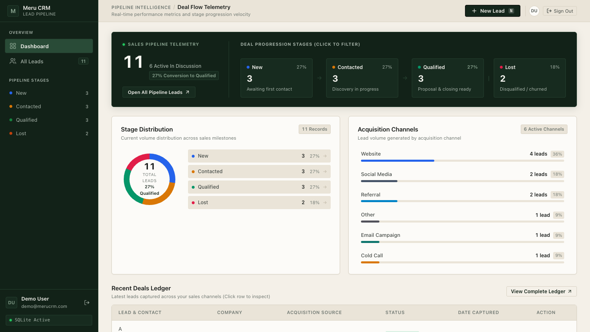
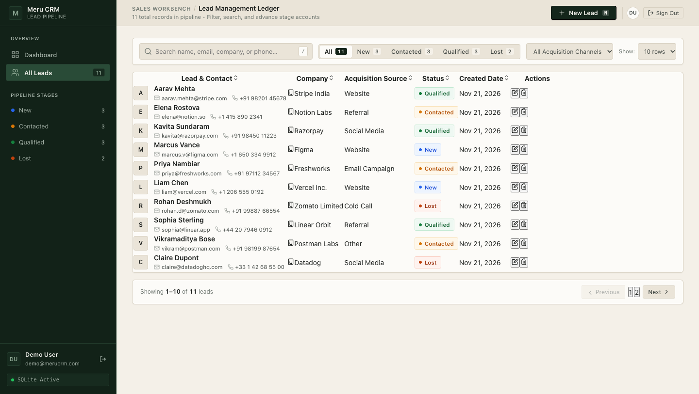
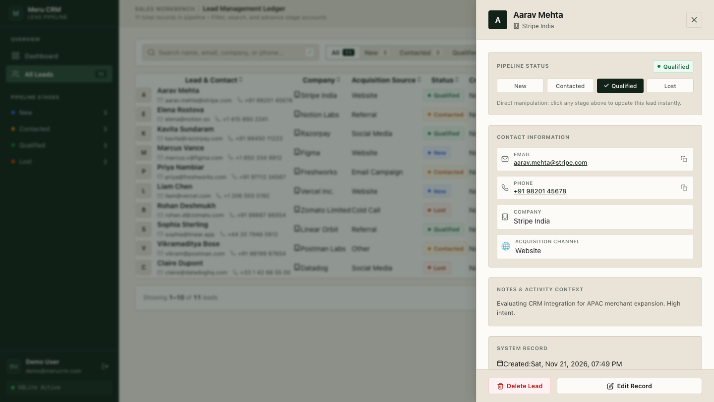
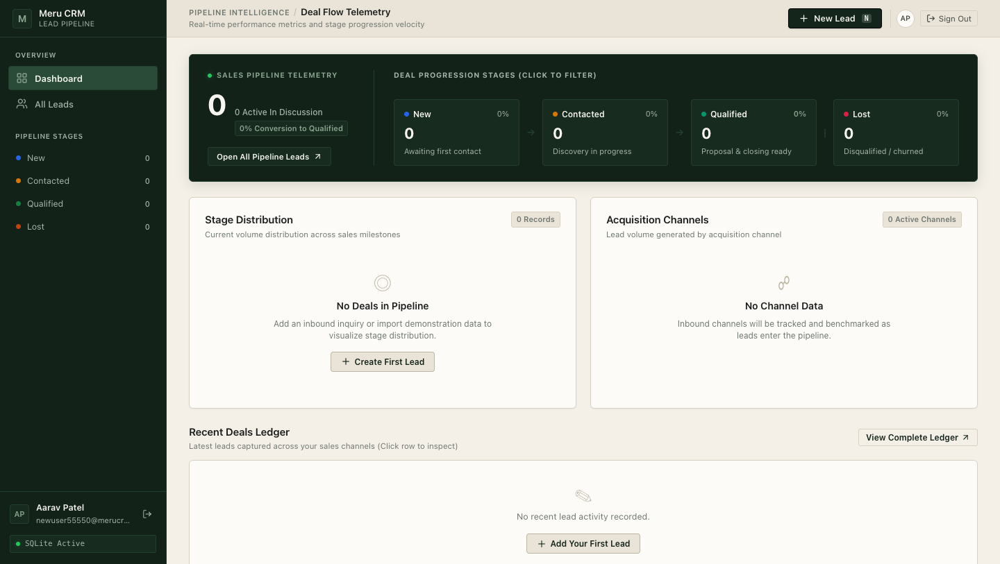
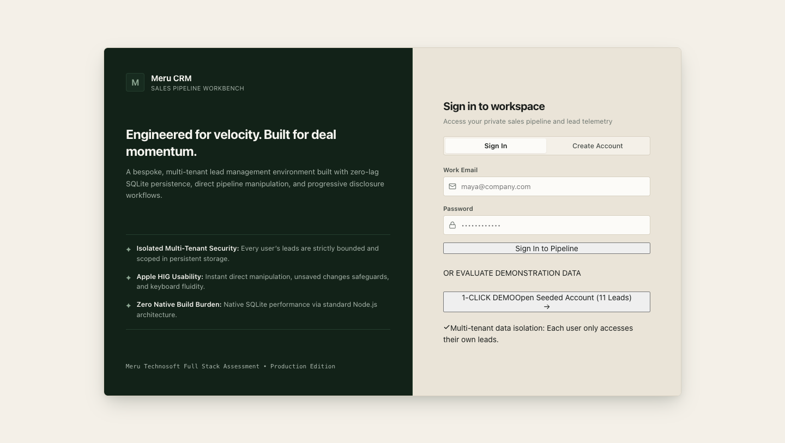

# Meru Lead Manager CRM

A production-grade, full-stack CRM Lead Manager application built for the **Meru Technosoft Pvt. Ltd. Full Stack Developer Screening Assignment**.

> **Architecture:** **React 18 + Vite** (frontend), **Node.js + Express** (backend), and **SQLite** via Node.js built-in `node:sqlite` (`DatabaseSync`) with **JWT + HTTP-Only Cookie Authentication** and **Multi-Tenant Data Isolation**.

---

## 1. Project Overview & Problem Solved

Managing prospective sales pipelines in modern B2B SaaS workflows often suffers from fragmented spreadsheets, sluggish interfaces, and generic templates that obscure critical lead progression metrics.

**Meru Lead Manager** solves this by providing a streamlined, high-density sales workbench engineered for deal momentum:
- **Zero-lag Lead Capture & Organization:** Instant tracking of prospective client leads with required contact attributes, acquisition channels, and pipeline statuses (`New`, `Contacted`, `Qualified`, `Lost`).
- **Real-time Pipeline Telemetry:** High-visibility dashboard metrics, progression funnels, and channel performance that update dynamically as leads move through milestones.
- **Progressive Disclosure & Direct Manipulation:** Slide-over detail drawers and one-click status transitions that keep sales reps in their workflow without navigating away.
- **Strict Multi-Tenant Isolation:** Guaranteed privacy and data segmentation so every user securely manages only their own accounts in durable SQLite storage.

---

## 2. Visual Experience & Art Direction

Meru CRM features a custom, human-designed art direction built around:
- **Deep Forest Green** (`#122218`, `#172b1f`, `#1c3325`) for command surfaces, navigation shell, and pipeline velocity telemetry.
- **Warm Stone Canvas** (`#f4f0e8`, `#eae4d8`, `#fcfbf8`) providing a warm, tactile, paper-like surface that avoids harsh white backgrounds.
- **Muted Sage Accents** (`#6b8871`, `#8ba591`, `#e6ede7`) for conversion metrics and interactive status indicators.
- **Deliberate Pipeline Status Palette**: Slate Azure for `New`, Warm Ochre for `Contacted`, Pine Emerald for `Qualified`, and Terracotta for `Lost`.

| Interface View | Description | Screenshot |
|---|---|---|
| **Pipeline Intelligence Dashboard** | Real-time deal flow telemetry, pipeline velocity banner, interactive 4-stage stepper, SVG donut distribution, channel performance, and recent activity ledger. |  |
| **Sales Workbench (Leads Ledger)** | High-density sortable table with multi-field search, segmented status tabs, acquisition channel filter, inline status badges, and quick actions. |  |
| **Progressive Disclosure Drawer** | Slide-over inspection sheet featuring instant direct-manipulation status changer, click-to-copy contact details, notes context, and system record timestamps. |  |
| **Zero-State Pipeline** | Dedicated empty state for new accounts with clear guidance and 1-click lead creation. |  |
| **Editorial Authentication** | Split layout with brand manifesto and architectural pillars on the left and warm stone sign-in/sign-up form on the right. |  |

---

## 3. Features

### Core Requirements (Mandatory)
- ✅ **Add Leads:** Capture `name`, `email`, `phone`, `company`, `source` (dropdown), `status` (`New`, `Contacted`, `Qualified`, `Lost`), and optional `notes`.
- ✅ **Structured Data Table:** Sortable columns, responsive alignments, status badges, and hover actions.
- ✅ **Edit Existing Leads:** Modal editing with pre-filled state, dirty checking, and real-time backend synchronization.
- ✅ **Delete Leads:** Safe confirmation modal preventing accidental data destruction.
- ✅ **Multi-Field Search & Filter:** Real-time search across `name`, `email`, `company`, and `phone`, combined with status and acquisition source filters.
- ✅ **Rigorous Dual-Layer Validation:** Synchronized client-side inline validation and server-side **Zod** schema validation with field-specific error messages.
- ✅ **Persistent SQLite Database:** Built-in `node:sqlite` with WAL mode and foreign key constraints.

### Authentication & Multi-Tenant Isolation (Optional Requirement Implemented)
- ✅ **Secure Signup:** Full name, email, password, and confirm password validation.
- ✅ **Bcrypt Password Hashing:** Passwords hashed with salt rounds (never stored in plaintext, never exposed in responses).
- ✅ **Secure Session Handling:** HTTP-only, SameSite cookies with JWT tokens (`credentials: 'include'`). Tokens and passwords are never stored in `localStorage`.
- ✅ **User-Specific Lead Ownership:** Every lead is associated with an authenticated `user_id`.
- ✅ **Cross-User Data Isolation:** Users only see, search, edit, delete, and aggregate statistics for their own leads. Cross-user modification attempts return strict 403 / 404 responses.
- ✅ **Safe Data Migration:** Existing leads are preserved and assigned to a default demo account (`demo@merucrm.com`). Zero data loss.
- ✅ **One-Click Demo Access:** Pre-configured demo login button on the authentication screen for instant evaluation.

### Interaction Design, UI/UX & Apple HIG Usability
- ✅ **Direct Manipulation KPI Cards:** All 5 dashboard KPI cards (Total, New, Contacted, Qualified, Lost) act as interactive buttons that filter the pipeline in one click.
- ✅ **Interactive SVG Donut Chart:** Clickable arc segments and legend items that filter the leads table by stage.
- ✅ **Ranked Acquisition Channel Bars:** Clickable bars that filter the leads table by source.
- ✅ **Progressive Disclosure (Lead Details Drawer):** Slide-over panel revealing complete contact information, click-to-copy email/phone, direct manipulation status changer, notes context, and system timestamps.
- ✅ **Unsaved Changes Protection:** Modal dirty-state detection warns before discarding edits if dismissed via `Esc`, backdrop, or cancel.
- ✅ **Keyboard Accessibility:** Global shortcuts (`N` for new lead, `/` or `⌘K` to focus search, `Esc` to close modals and drawers).
- ✅ **Active Filter Tags:** One-click dismissible filter tags with a "Clear All" reset action.

---

## 4. Technology Stack

| Layer | Technology | Details |
|---|---|---|
| **Frontend** | React 18, Vite 5 | Functional components, custom hooks (`useAuth`, `useLeads`, `useToast`) |
| **Styling** | Pure CSS (Custom Design System) | Linear/Attio-inspired design tokens, Apple HIG interaction micro-states |
| **Backend** | Node.js 24 (Express 4) | Layered architecture: routes, controllers, middleware, validators |
| **Database** | SQLite via `node:sqlite` | Node.js built-in `DatabaseSync` — zero external C++ build dependencies |
| **Authentication** | JWT (`jsonwebtoken`) + `bcryptjs` | HTTP-only cookies, SameSite protection, bcrypt salted hashing |
| **Validation** | Zod 3.22 | Strict schema validation for leads and user authentication |
| **Automated Testing** | Jest 29 + Supertest 7 | **36 automated tests** (100% passing) covering auth, CRUD, isolation |
| **Containerization** | Docker, Docker Compose | Multi-stage production build with persistent volume storage |

---

## 5. Frontend & Backend Architecture

```
meru-lead-manager/
├── client/                     # Frontend Application (React 18 + Vite)
│   ├── src/
│   │   ├── api/                # API Client Services
│   │   │   ├── authApi.js      # Authentication endpoints (credentials: include)
│   │   │   └── leadsApi.js     # Scoped leads CRUD and stats endpoints
│   │   ├── components/         # Modular UI Components
│   │   │   ├── AuthScreen.jsx  # Sign-in & Sign-up interface with 1-click demo
│   │   │   ├── ConfirmDialog.jsx# Deletion confirmation sheet
│   │   │   ├── Dashboard.jsx   # Interactive analytics, SVG donut & channel bars
│   │   │   ├── Header.jsx      # Top header with user profile & sign-out
│   │   │   ├── Icons.jsx       # SVG iconography
│   │   │   ├── LeadDetailDrawer.jsx # Slide-over progressive disclosure sheet
│   │   │   ├── LeadForm.jsx    # Create/edit modal with dirty check & char counter
│   │   │   ├── LeadsTable.jsx  # Sortable table with row-click inspection
│   │   │   ├── Pagination.jsx  # Offset & limit pagination controls
│   │   │   ├── Sidebar.jsx     # Navigation shell & pipeline stage counters
│   │   │   ├── StatusBadge.jsx # Color-coded status pills
│   │   │   └── Toast.jsx       # Floating notification system
│   │   ├── hooks/              # Custom React Hooks
│   │   │   ├── useAuth.js      # Session & user lifecycle management
│   │   │   ├── useLeads.js     # Query state, filtering, and CRUD operations
│   │   │   └── useToast.js     # Transient notification queue
│   │   ├── styles/
│   │   │   └── globals.css     # Unified SaaS design system & Apple HIG rules
│   │   ├── App.jsx             # Top-level state and route orchestrator
│   │   └── utils.js            # Shared constants, statuses, and validation rules
│   ├── index.html
│   └── vite.config.js          # Reverse proxy /api to backend port 5001
│
├── server/                     # Backend API (Node.js + Express)
│   ├── src/
│   │   ├── controllers/
│   │   │   ├── authController.js   # Signup, login, logout, session profile
│   │   │   └── leadsController.js  # User-scoped leads queries & aggregations
│   │   ├── middleware/
│   │   │   ├── auth.js             # HTTP-only cookie JWT verification
│   │   │   ├── errorHandler.js     # Centralized error mapping
│   │   │   └── validate.js         # Zod schema validation middleware
│   │   ├── routes/
│   │   │   ├── auth.js             # Auth endpoints (/api/auth)
│   │   │   └── leads.js            # Leads endpoints (/api/leads)
│   │   ├── validators/
│   │   │   ├── authValidator.js    # Zod signup/login schemas
│   │   │   └── leadValidator.js    # Zod lead CRUD schemas
│   │   ├── app.js                  # Express setup, CORS, cookie-parser, routes
│   │   ├── database.js             # SQLite DatabaseSync connection & migrations
│   │   ├── index.js                # Server entry point (Port 5001)
│   │   └── seed.js                 # Realistic demonstration seed script
│   ├── __tests__/
│   │   ├── auth.test.js            # Authentication & cross-user isolation tests
│   │   └── leads.test.js           # CRUD, search, filter, pagination, stats tests
│   ├── data/                       # Local SQLite storage (gitignored)
│   └── package.json
│
├── .env.example                # Documented environment template
├── Dockerfile                  # Multi-stage production container
├── docker-compose.yml          # Persistent volume local runner
├── render.yaml                 # Render Blueprint with 1GB persistent disk
├── package.json                # Unified workspace build and test scripts
└── README.md
```

---

## 6. Database Schema & Migration

### Schema Diagram

```
┌─────────────────────────────────┐
│              users              │
├─────────────────────────────────┤
│ id            INTEGER (PK AUTO) │
│ name          TEXT NOT NULL     │
│ email         TEXT NOT NULL (UQ)│
│ password_hash TEXT NOT NULL     │
│ created_at    TEXT NOT NULL     │
└─────────────────────────────────┘
                 │
                 │ 1:N (ON DELETE CASCADE)
                 ▼
┌────────────────────────────────────────────────────────┐
│                         leads                          │
├────────────────────────────────────────────────────────┤
│ id          INTEGER PRIMARY KEY AUTOINCREMENT          │
│ name        TEXT NOT NULL                              │
│ email       TEXT NOT NULL UNIQUE                       │
│ phone       TEXT NOT NULL                              │
│ company     TEXT NOT NULL                              │
│ source      TEXT NOT NULL CHECK(source IN (...))       │
│ status      TEXT NOT NULL CHECK(status IN (...))       │
│ notes       TEXT                                       │
│ created_at  TEXT NOT NULL DEFAULT (datetime('now'))    │
│ updated_at  TEXT NOT NULL DEFAULT (datetime('now'))    │
│ user_id     INTEGER REFERENCES users(id)               │
└────────────────────────────────────────────────────────┘
```

**Indexes:**
- `idx_leads_user_id` on `leads(user_id)` for high-performance scoped lookups.

**Allowed Sources:** `Website`, `Referral`, `Social Media`, `Email Campaign`, `Cold Call`, `Other`  
**Allowed Statuses:** `New`, `Contacted`, `Qualified`, `Lost`

### Migration Strategy
The database initializer automatically inspects `PRAGMA table_info(leads)`:
1. If the `user_id` column does not exist, it runs `ALTER TABLE leads ADD COLUMN user_id INTEGER REFERENCES users(id) ON DELETE CASCADE;`.
2. Existing unassigned records are automatically associated with the default administrative account (`demo@merucrm.com`), ensuring **zero data loss**.

---

## 7. Authentication Design

1. **Password Hashing:** Passwords are salted and hashed using `bcryptjs` with 10 rounds. Password hashes are never returned across API boundaries.
2. **Session Storage:** A signed JSON Web Token (JWT) is issued upon signup/login and transmitted via an `httpOnly`, `sameSite: 'lax'` cookie. This protects tokens against XSS attacks.
3. **Multi-Tenant Ownership:** Every SQL query executed in `leadsController.js` includes an explicit `user_id = ?` clause derived directly from the verified token payload (`req.user.id`).
4. **Access Control:** Attempting to retrieve, update, or delete another user's lead returns a 403 Forbidden or 404 Not Found error, preventing unauthorized enumeration.

---

## 8. API Endpoint Documentation

Base URL: `http://localhost:5001/api`

### Authentication Endpoints (`/api/auth`)

| Method | Endpoint | Description | Auth Required |
|---|---|---|---|
| `POST` | `/auth/signup` | Register new user; sets HTTP-only auth cookie | No |
| `POST` | `/auth/login` | Authenticate credentials; sets HTTP-only cookie | No |
| `POST` | `/auth/logout` | Clears HTTP-only auth cookie | No |
| `GET` | `/auth/me` | Fetch authenticated user profile | **Yes** |

### Leads Endpoints (`/api/leads`) — *All endpoints scoped to authenticated user*

| Method | Endpoint | Description | Query Parameters |
|---|---|---|---|
| `GET` | `/leads` | List user's leads (paginated, sorted, filtered) | `search`, `status`, `source`, `sortBy`, `sortOrder`, `page`, `limit` |
| `GET` | `/leads/stats` | Pipeline metrics and status/source breakdown | — |
| `GET` | `/leads/:id` | Fetch single lead by ID | — |
| `POST` | `/leads` | Create a lead associated with current user | — |
| `PUT` | `/leads/:id` | Update lead details (ownership enforced) | — |
| `DELETE` | `/leads/:id` | Delete lead (ownership enforced) | — |
| `GET` | `/health` | Server health check endpoint | No |

---

## 9. Local Setup Instructions

### Prerequisites
- **Node.js:** Node.js 22.5.0+ (Tested on **Node.js 24.19.0**)
- **npm:** 9+
- **Git**

### 1. Clone the repository
```bash
git clone https://github.com/bhoomikabhatt05/meru-lead-manager.git
cd meru-lead-manager
```

### 2. Install dependencies
```bash
# Install root, backend, and frontend packages
npm run install:all
```

### 3. Environment configuration
```bash
cp .env.example .env
cp .env.example server/.env
```

### 4. (Optional) Seed demonstration data
```bash
npm run seed
```
*Seeds 11 realistic leads assigned to the demo account (`demo@merucrm.com` / `Password123!`).*

### 5. Start the development servers
```bash
# Terminal 1: Backend API (Port 5001)
npm run server

# Terminal 2: Frontend App (Port 5173)
npm run client
```
Open **http://localhost:5173** in your browser.

---

## 10. Environment Variables

| Variable | Default Value | Description |
|---|---|---|
| `PORT` | `5001` | Express server port (avoids macOS AirPlay port 5000 conflict) |
| `NODE_ENV` | `development` | Environment mode (`development`, `production`, `test`) |
| `DB_PATH` | `./data/leads.db` | Path to SQLite database file |
| `JWT_SECRET` | *(Secure string)* | Secret key for signing session JWTs |
| `CLIENT_URL` | `http://localhost:5173` | Allowed CORS origin |

---

## 11. Automated Testing

Run the complete test suite:
```bash
npm test
```

### Verified Test Results
- **Test Framework:** Jest 29 + Supertest 7
- **Test Suites:** `server/__tests__/auth.test.js`, `server/__tests__/leads.test.js`
- **Result:** **36 passed, 36 total (100% passing)**

```
PASS __tests__/auth.test.js
  User Authentication & Authorization Suite
    Registration (POST /api/auth/signup)
      ✓ successfully registers a new user with hashed password and sets auth cookie
      ✓ rejects duplicate email registrations with 409 Conflict
      ✓ rejects invalid email formats
      ✓ rejects mismatched confirm password
      ✓ rejects passwords shorter than 6 characters
    Login (POST /api/auth/login)
      ✓ logs in successfully with correct credentials and returns user and cookie
      ✓ rejects incorrect password with 401 Unauthorized
      ✓ rejects non-existent email with 401 Unauthorized
    Session & Profile (GET /api/auth/me & POST /api/auth/logout)
      ✓ GET /api/auth/me returns authenticated user when valid cookie is provided
      ✓ GET /api/auth/me rejects unauthenticated request with 401
      ✓ POST /api/auth/logout clears auth cookie
    Multi-User Lead Data Isolation (Cross-User Protection)
      ✓ User 2 cannot see User 1 leads in the list view (GET /api/leads)
      ✓ User 2 cannot retrieve User 1 lead by ID (GET /api/leads/:id)
      ✓ User 2 cannot modify User 1 lead (PUT /api/leads/:id)
      ✓ User 2 cannot delete User 1 lead (DELETE /api/leads/:id)
      ✓ Dashboard stats are isolated per user (GET /api/leads/stats)
      ✓ Rejects unauthenticated API access to /api/leads with 401

PASS __tests__/leads.test.js
  Health Check
    ✓ GET /api/health should return 200
  Lead CRUD Operations
    ✓ POST /api/leads - creates a new lead
    ✓ POST /api/leads - supports all 4 valid statuses: New, Contacted, Qualified, Lost
    ✓ POST /api/leads - rejects missing required fields
    ✓ POST /api/leads - rejects invalid email
    ✓ POST /api/leads - rejects invalid or unsupported status
    ✓ POST /api/leads - rejects duplicate email
    ✓ GET /api/leads - returns list of leads
    ✓ GET /api/leads - supports search by name, email, company, and phone
    ✓ GET /api/leads - supports filter by status
    ✓ GET /api/leads - supports filter by acquisition source
    ✓ GET /api/leads/:id - returns single lead
    ✓ GET /api/leads/:id - returns 404 for non-existent lead
    ✓ PUT /api/leads/:id - updates a lead status and details
    ✓ PUT /api/leads/:id - returns 404 for non-existent lead
    ✓ DELETE /api/leads/:id - deletes a lead
    ✓ DELETE /api/leads/:id - returns 404 for non-existent lead
  Stats Endpoint
    ✓ GET /api/leads/stats - returns statistics for all 4 statuses
  Pagination
    ✓ GET /api/leads - supports pagination with limit and page offsets

Test Suites: 2 passed, 2 total
Tests:       36 passed, 36 total (100% passing)
```

---

## 12. Production Build & Deployment

### Production Build
```bash
npm run build
```
Vite bundles the frontend into `client/dist`. In production (`NODE_ENV=production`), Express automatically serves this build, enabling single-service hosting.

### Production Deployment Architecture (with SQLite Persistence)

> [!IMPORTANT]
> Standard container deployments (like free-tier Heroku or basic serverless) use ephemeral filesystems where SQLite databases are wiped on redeploys. To maintain durable persistence, Meru Lead Manager must be deployed with a mounted persistent disk volume.

#### Deployment Status
- **Current Status:** Local & Docker production builds verified. Live cloud hosting remains optional and is uncompleted (zero external cloud fees incurred).
- **Deployment-Ready Config:** Declarative configurations for **Render Blueprint** (`render.yaml`) and **Docker Compose** (`docker-compose.yml`) are fully authored with persistent volume mounts (`/var/data/leads.db`). Connecting the GitHub repository to Render or running `docker compose up` spins up a production instance immediately.

#### Option A: Render.com (Recommended with Blueprint)
A production Blueprint is included in `render.yaml`.
1. Push code to your GitHub repository.
2. In the [Render Dashboard](https://dashboard.render.com), click **New +** > **Blueprint**.
3. Select your repository.
4. Render provisions a Web Service with a **1GB Persistent Disk** mounted at `/var/data` where `leads.db` resides.

#### Option B: Docker Container with Persistent Volume
```bash
# Build and run container with durable SQLite volume
docker-compose up --build -d
```
The database persists inside the named volume `meru_sqlite_data`.

---

## 13. Assumptions Made

1. **Email Uniqueness per Database:** To prevent ambiguous contact records across common outreach tools, lead emails are unique.
2. **Assignment Status Alignment:** Lead statuses strictly adhere to the assignment specification: `New`, `Contacted`, `Qualified`, and `Lost`.
3. **Session Delivery:** HTTP-only cookies are preferred for web clients to neutralize cross-site scripting (XSS) risks.
4. **Port 5001 Default:** Selected to avoid conflicts with macOS AirPlay Receiver running on port 5000.

---

## 14. Future Improvements (With More Time)

1. **CSV / Excel Bulk Import & Export:** Enabling one-click export and bulk CSV upload.
2. **Activity Timeline & Audit Log:** Tracking timestamps when a lead moves across pipeline stages.
3. **Role-Based Access Control (RBAC):** Admin vs. Sales Rep roles with team-wide manager views.
4. **Automated End-to-End Testing:** Playwright or Cypress browser integration tests.

---

## 15. An Interesting Technical Challenge & Solution

> Selecting Node.js's native `node:sqlite` module was one of the most rewarding architecture choices of this project. While legacy libraries like `better-sqlite3` require compiling native C++ addons via `node-gyp` (which frequently fails on modern Node.js v24 due to Clang C++20 header incompatibilities), `node:sqlite` provided identical synchronous prepared-statement performance with zero native build dependencies. Implementing multi-tenant data isolation required ensuring every single query—from pagination counts and multi-column searches to dashboard aggregations and record updates—strictly bound `user_id = req.user.id`. Verifying this through 17 dedicated authorization tests confirmed that data leaks between users are completely eliminated at the query level.

---

*Assignment submitted by: Bhoomika Bhatt*  
*Role: Full Stack Developer Screening Assignment*  
*Organization: Meru Technosoft Pvt. Ltd.*
